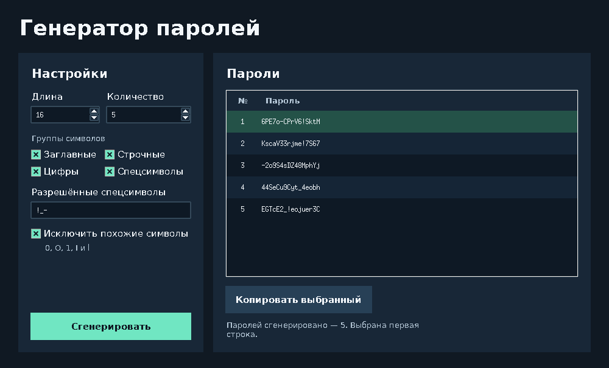

# Генератор и менеджер паролей

Учебный проект на Python 3.12. Один модуль генерации используется в двух режимах.

- **Генератор с окном** работает локально на Tkinter. Можно настроить длину, количество и группы символов, а потом скопировать выбранный пароль из таблицы. Список существует, пока открыто окно.
- **Менеджер в терминале** использует SQLite для хранения записей и Fernet для шифрования паролей. При входе запрашивается мастер-пароль.

## Демо

[Видео второго задания — 1 минута 16 секунд](docs/password_manager_homework.mp4)



## Генератор на Windows

Скачай проект через **Code → Download ZIP** и распакуй его в отдельную папку. Если на компьютере установлен Python 3.12 с Tkinter, запусти `start_generator.cmd` двойным щелчком. То же самое можно сделать в PowerShell из папки проекта.

```powershell
py -3.12 .\generator_gui.py
```

В поле «Длина» по умолчанию стоит 16 символов. Выбери нужное количество паролей и группы символов, затем нажми **«Сгенерировать»**. Выбери строку таблицы и нажми **«Копировать выбранный»**.

Два параметра для продвинутого задания работают в окне и в терминале:

- **Исключить похожие символы** убирает `0`, `O`, `1`, `I` и `l`.
- **Разрешённые спецсимволы** ограничивают выбор введённым набором. Например, при `!_-` генератор берёт спецсимволы только из этих трёх. В пароле есть хотя бы по одному символу из каждой включённой группы.

## Менеджер для проверки домашнего задания

Открой папку проекта в VS Code, затем выполни в терминале PowerShell:

```powershell
py -3.12 -m venv .venv
.\.venv\Scripts\python.exe -m pip install -r requirements.txt
.\.venv\Scripts\python.exe .\password_manager.py
```

При первом запуске придумай мастер-пароль и введи его дважды. Ввод скрыт, поэтому в строке символы не появляются. При следующих запусках введи тот же мастер-пароль.

| Команда | Что делает |
| --- | --- |
| `new` | Генерирует пароль с выбранными параметрами |
| `add` | Сохраняет запись с введённым или сгенерированным паролем |
| `list` | Показывает таблицу с названиями сервисов и логинами |
| `get` | Показывает пароль записи по её названию после входа |
| `delete` | Удаляет запись после подтверждения |
| `exit` | Завершает сеанс |

В терминале результат `new` или `get` можно выделить мышью и скопировать через пункт **Copy** в контекстном меню терминала VS Code.

Менеджер хранит хэш мастер-пароля SHA-256 по условиям курса. Файл `.key` позволяет расшифровать записи из `password.db`. Эти файлы исключены из Git. Для демонстрации используй вымышленные записи.

## Как проверить продвинутое задание

1. В окне генератора оставь длину **16** и включи все четыре группы символов. Введи `!_-` в поле разрешённых спецсимволов. Включи исключение похожих символов и нажми **«Сгенерировать»**.
2. Проверь длину результатов и набор символов. Спецсимволы должны быть из `!_-`, а `0`, `O`, `1`, `I` и `l` исключаются. Кнопка **«Копировать выбранный»** переносит в буфер обмена пароль выбранной строки.
3. Запусти терминальный менеджер и выполни `new` с такими же параметрами. Затем добавь две пробные записи через `add` и вызови `list`. В таблице появятся названия сервисов и логины.

## Как передать генератор другому человеку

На Windows запусти `build_generator.cmd` двойным щелчком. Скрипт устанавливает PyInstaller в отдельное окружение `.build-venv` и собирает файл `dist\PasswordGenerator.exe`. Для установки PyInstaller нужен интернет. После сборки передавай только этот `.exe`. На компьютере получателя Python и интернет для генерации не требуются.

## Файлы

| Файл | Назначение |
| --- | --- |
| `password_gen.py` | Общие настройки и генерация через `secrets` |
| `generator_gui.py` | Окно генератора и копирование из таблицы |
| `password_manager.py` | Меню, проверка мастер-пароля, база и шифрование |
